# Atropos purchase pipeline

Локальный стенд генерирует события о покупке продуктовой корзины, отправляет их в Kafka и сохраняет в PostgreSQL. Liquibase создаёт схему БД, VictoriaMetrics собирает метрики Python-процессов, а Grafana содержит готовый dashboard.

## Запуск инфраструктуры

Из корня проекта:

```powershell
make up
make ps
```

`make up` сначала запускает portable `windows_exporter` на Windows-хосте, а затем
поднимает Docker Compose. При первом запуске exporter автоматически скачивается в
`.tools/windows_exporter` и использует конфигурацию `infra/we/config.yml`.
Версию можно переопределить переменной окружения `WINDOWS_EXPORTER_VERSION`.

Compose использует локальные значения по умолчанию. Чтобы их изменить, скопируйте `infra/.env.example` в `infra/.env` и отредактируйте файл.

Сервисы:

- Kafka: `localhost:9092`, topic `cart-purchases`;
- PostgreSQL: `localhost:5432`, БД/пользователь/пароль `atropos`;
- VictoriaMetrics: <http://localhost:8428>;
- Grafana: <http://localhost:3000>, логин/пароль `admin`/`admin`.

Liquibase запускается после readiness PostgreSQL и завершается после применения миграции. `kafka-init` аналогично создаёт topic и завершается.

## Запуск скриптов

Требуется Python 3.12+:

```powershell
python -m venv .venv
.\.venv\Scripts\Activate.ps1
python -m pip install -e .
```

В первом терминале запустите consumer:

```powershell
python research/scripts/consumer.py
```

Во втором терминале запустите producer:

```powershell
python research/scripts/producer.py
```

Producer работает до `Ctrl+C`, создавая одно сообщение в секунду. Для конечного прогона:

```powershell
python research/scripts/producer.py --count 100 --interval 0.1
```

Каждое событие содержит от 1 до 10 разных продуктов; у каждой позиции есть количество, цена и сумма. Consumer валидирует итоговую сумму и фиксирует Kafka offset только после успешной транзакции PostgreSQL. Повторная доставка покупки безопасна благодаря первичному ключу `purchase_id`.

Проверить данные:

```powershell
docker compose -f infra/docker-compose.yml exec postgres psql -U atropos -d atropos -c "SELECT purchase_id, purchased_at, total_amount FROM purchases ORDER BY purchased_at DESC LIMIT 10;"
```

Метрики producer и consumer доступны на портах `8001` и `8002`. VictoriaMetrics опрашивает их через `host.docker.internal`; dashboard `Atropos purchase pipeline` автоматически появляется в Grafana.

Остановка:

```powershell
make down
```

Флаг `--volumes` удаляет Docker volumes остальных сервисов. Метрики в `VM_DATA_PATH` при этом сохраняются; подробнее см. [хранение VictoriaMetrics](infra/victoria-metrics/README.md).

## UI и сервер в Docker

```powershell
make service-up
make service-ps
```

Команда собирает и запускает UI, вычислительный backend, PostgreSQL и миграции.
UI: [http://localhost:8501](http://localhost:8501), health сервера:
[http://localhost:8000/healthz](http://localhost:8000/healthz).
`make ui` запускает тот же стек в фоне. Остановка: `make service-down`.
Для локальной разработки через UV используйте `make ui-local`.
Подробности: [контейнеры и команды](docs/CONTAINERS.md).

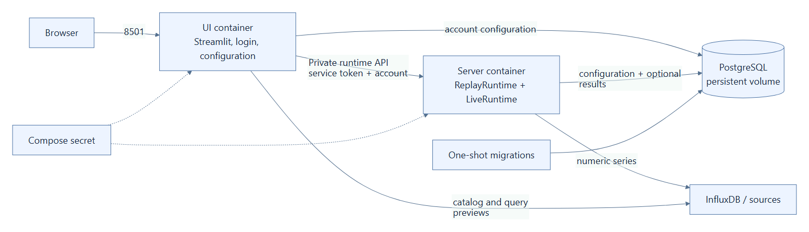

## UI управления метриками

Модуль [`ui`](ui/README.md) использует Python 3.12+, UV, Streamlit и Plotly.
Страницы: авторизация, подключения InfluxDB/VM/Prometheus/ClickHouse, каталог и редактор PromQL,
визуализация текущих значений и рядов, просмотр серверного `/metrics`.

```powershell
uv --directory ui sync --locked
$env:ATROPOS_UI_DEMO = '1'
uv --directory ui run --locked python -m atropos_ui.serve
```

Демо работает без внешних сервисов и показывает синтетические данные.
Для реальных подключений отключите деморежим и настройте пароль по [инструкции UI](ui/README.md).
Контейнерный запуск всего приложения: `make service-up`; только БД для разработки: `make config-up`.
Схема, настройка и импорт старой конфигурации описаны в [инструкции сервиса](infra/service/README.md).
Из корня доступны `make ui-sync`, `make ui-password-hash`, `make ui`, `make ui-test`.
Реализованный [runtime API](ui/RUNTIME_API.md). Отдельный будущий контракт производных PromQL-метрик: [ui/SERVER_API.md](ui/SERVER_API.md).

## Архитектура сервиса и целостность

[Документация и исходники диаграмм](docs/README.md) · [Отчёт проверки от 21.11.2026](docs/INTEGRITY_REPORT.md)

Проверки после исправлений: 552 теста успешно, 14 live-тестов пропущено; UI Ruff — без ошибок.
Обе проблемы валидации исправлены, PostgreSQL-проверки выполнены на отдельной временной БД.
Добавлены параметры запусков и продолжение live-потоков между окнами.
Подробности: [исправления и архитектура](docs/REMEDIATION.md).

### Диаграммы классов

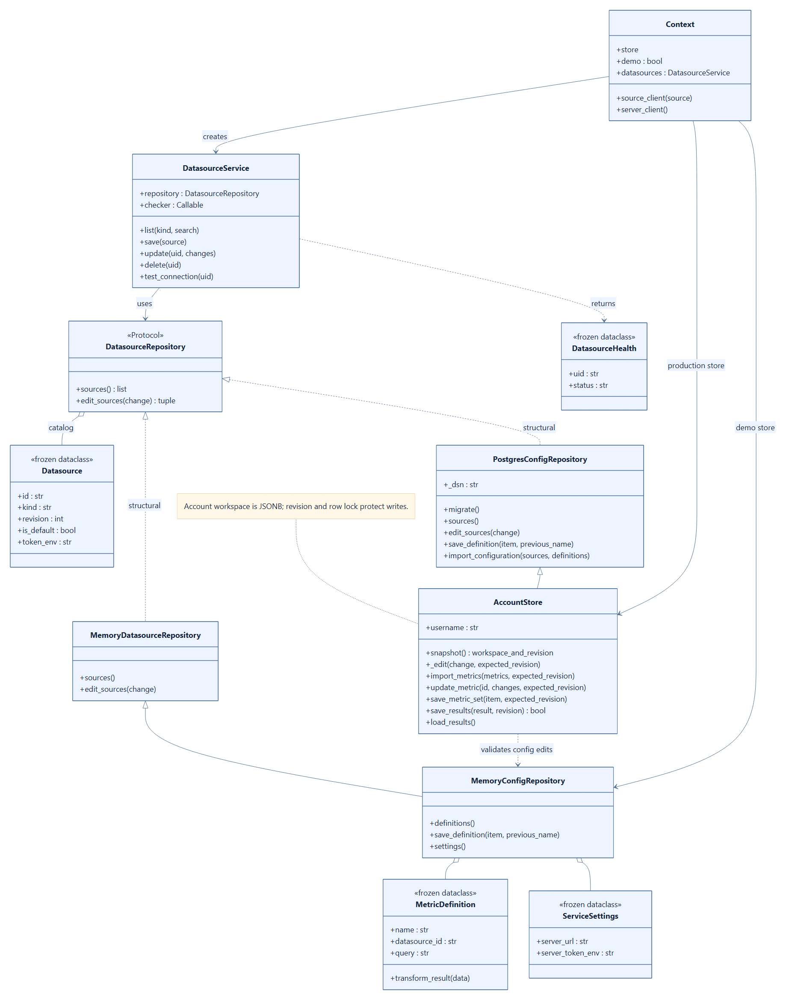

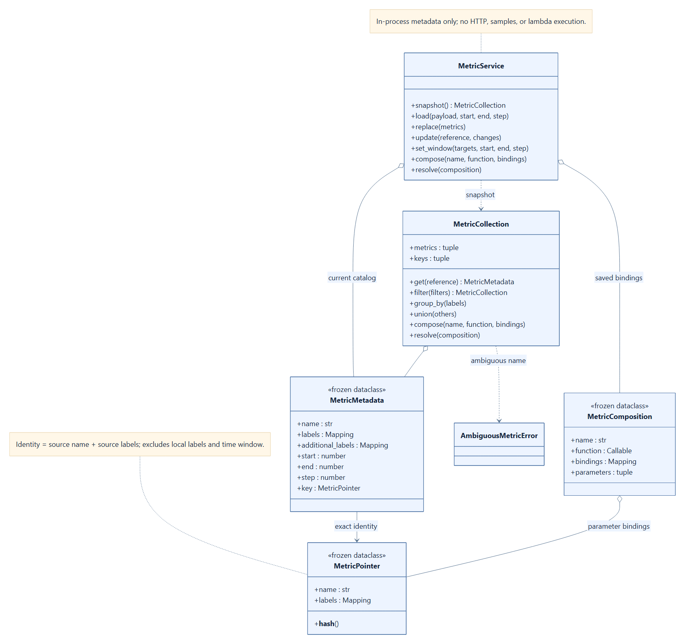

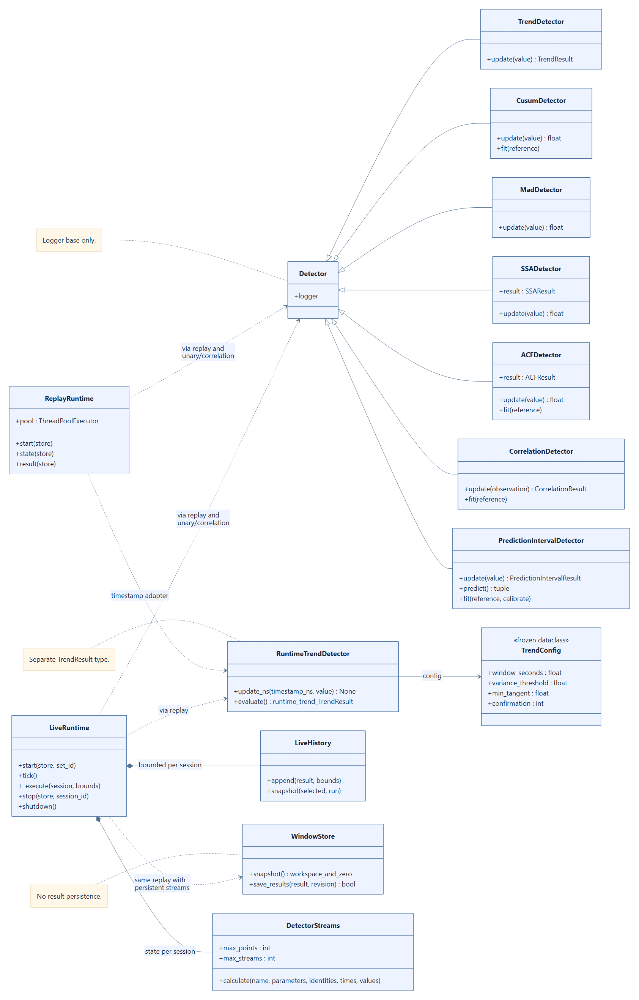

### Общие потоки выполнения

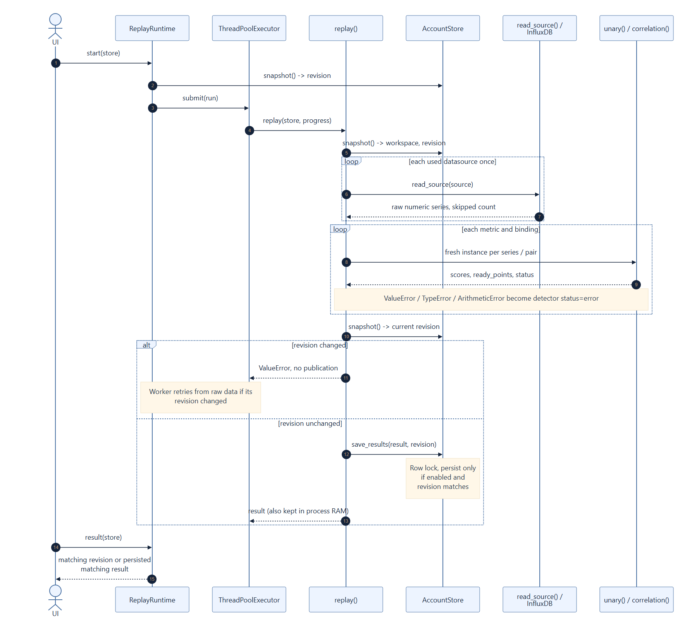

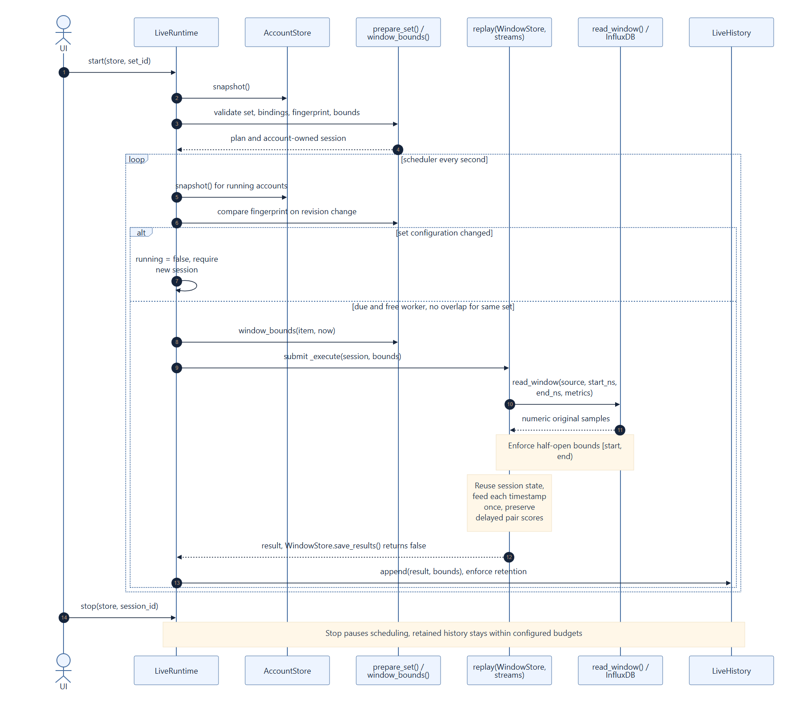

### Sequence-диаграммы детекторов

**Trend: изменение наклона**

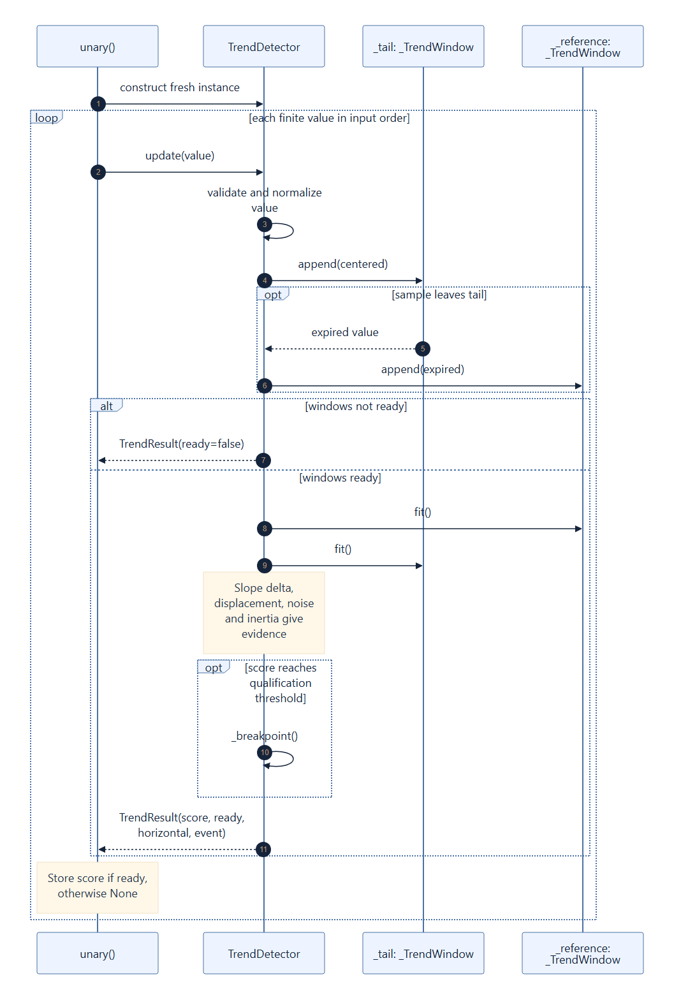

**CUSUM: двунаправленное отклонение**

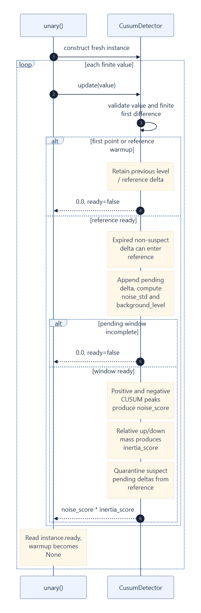

**MAD: изменение среднего абсолютного отклонения**

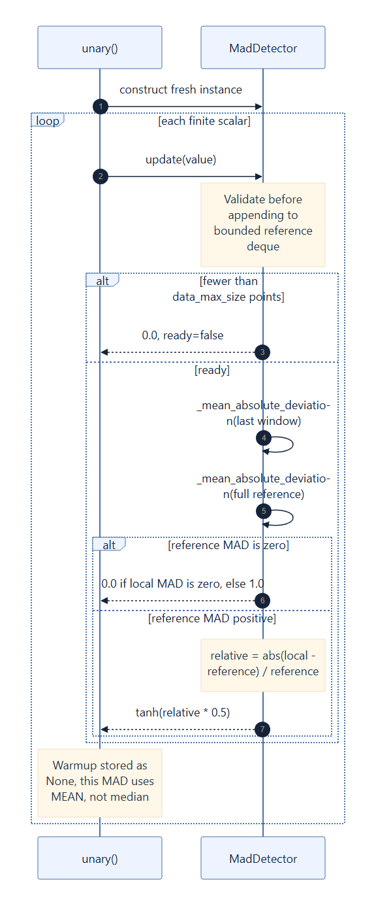

**SSA: изменение структуры ряда**

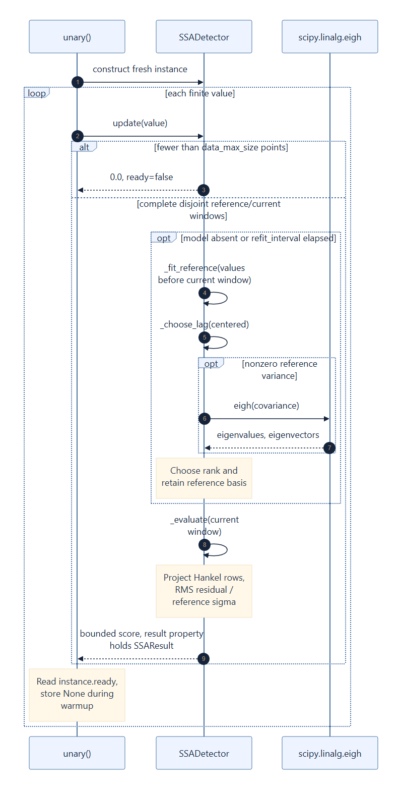

**ACF: изменение профиля автокорреляции**

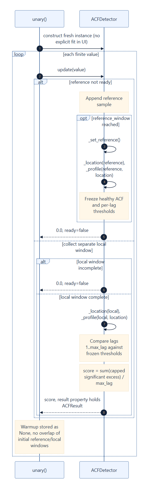

**Correlation: согласование пары и задержанный score**

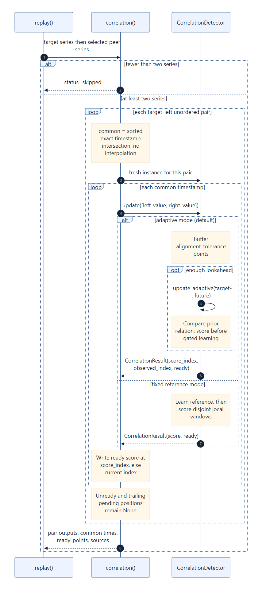

**PredictionInterval: оценка до обучения**

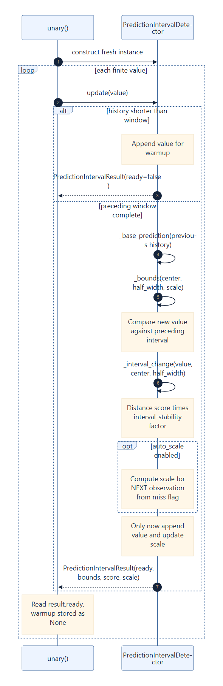

**RuntimeTrend: тренд по реальному времени**

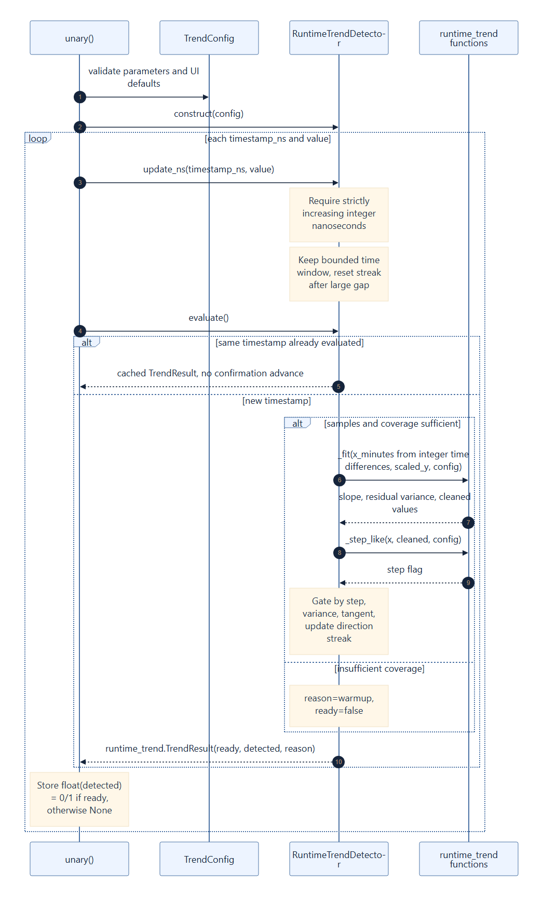

