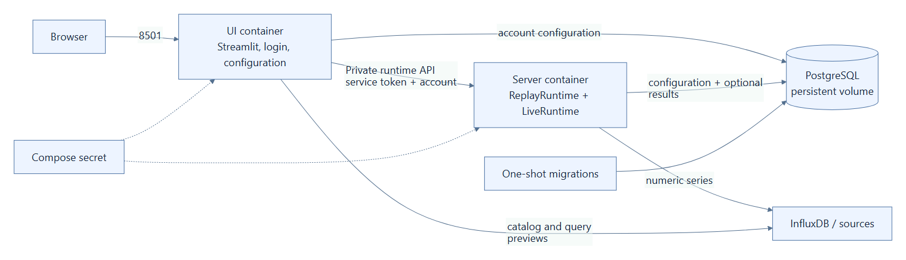

# Контейнеры Atropos

Из корня репозитория:

```powershell
make service-up
make service-ps
```

`make ui` и `make ui-up` — тот же запуск всего стека в фоне. `make up` дополнительно
запускает его вместе с прежней purchase-инфраструктурой и windows_exporter.

После успешного запуска:

- UI: [http://localhost:8501](http://localhost:8501).
- Health backend: [http://localhost:8000/healthz](http://localhost:8000/healthz).
- PostgreSQL конфигурации: `127.0.0.1:55432`.

Порядок: PostgreSQL healthy → успешные миграции → server healthy → UI healthy.
Мигратор после применения схемы завершается с кодом 0 — это штатное состояние.
Схема и именованный volume PostgreSQL сохранены от прежнего Compose-проекта `atropos-service`.



[Mermaid](diagrams/container-runtime.mmd) · [SVG](images/container-runtime.svg)

## Команды

| Make-цель | Действие |
|---|---|
| `service-up`, `ui`, `ui-up` | Сборка образов, запуск полного стека, ожидание health |
| `server-up` | Backend, PostgreSQL и миграции |
| `service-build` | Сборка образов UI и backend |
| `service-ps` | Статус всех контейнеров, включая завершившийся мигратор |
| `service-logs` | Логи UI, backend и PostgreSQL |
| `service-down` | Остановка и удаление контейнеров, сохранение volume БД |
| `config-up` | Только PostgreSQL и миграции |
| `ui-local` | PostgreSQL в Docker, UI и расчёты на хосте через UV |
| `user-create ACCOUNT=login` | Создать пустую учётку; пароль вводится скрыто |

Для запуска нужны Docker с Linux-контейнерами, Docker Compose 2.30+,
GNU Make и Python 3.12+ на хосте. Python нужен короткому bootstrap-скрипту;
для контейнерного запуска устанавливать зависимости UI через UV на хост не требуется.
Образы используют Python 3.12 slim и зависимости из `ui/uv.lock` через `uv sync --locked`.

Без Make:

```powershell
python infra/service/bootstrap.py
docker compose -f infra/docker-compose-service.yml up -d --build --wait server ui
```

## Конфигурация и секреты

`infra/service.env` (из [примера](../infra/service.env.example)) задаёт порты,
параметры PostgreSQL и лимиты памяти контейнеров. Make передаёт его как Compose `--env-file`.
При прямом использовании Compose добавьте `--env-file infra/service.env` самостоятельно.

Необязательный `infra/runtime.env` (из [примера](../infra/runtime.env.example)) передаёт
UI и backend переменные с токенами источников, legacy-хеш пароля и [бюджеты](REMEDIATION.md).
Это raw env-file: значения пишутся без кавычек, символы `$` сохраняются буквально.
Изменение этого файла применяется повторным `make service-up`.

`infra/service/bootstrap.py` один раз создаёт случайный внутренний token в
`infra/service/.runtime/token`. Существующий token не перезаписывается и не выводится.
Compose монтирует файл только в UI и server через `/run/secrets/runtime_token`.
Файл исключён из Git и build context. Он не заменяет пароли пользователей.

Оба приложения работают от UID 10001, с read-only корневой файловой системой,
записываемым `/tmp`, снятыми capabilities и лимитами памяти (server 2 GiB, UI 1 GiB по умолчанию).
PostgreSQL хранит постоянную конфигурацию в volume; `service-down` его не удаляет.

У пользователей сохраняются существующие PostgreSQL-учётки. Для создания новой:

```powershell
make user-create ACCOUNT=test
```

Команда выполняется при работающем server (`make service-up`). Пароль вводится скрыто,
минимум 12 символов; передавать его параметром Make не нужно. Хеш создаётся автоматически.
Если `ACCOUNT` не задан, Make выводит подсказку и завершает работу. Существующая
учётка не перезаписывается. Настройки Compose из `infra/service.env` подхватываются автоматически.
В контейнерах подключение БД строится из `PGHOST/PGPORT/PGDATABASE/PGUSER/PGPASSWORD`,
поэтому специальные символы пароля не ломают URI. Явный `ATROPOS_CONFIG_DATABASE_URL`
по-прежнему имеет приоритет; host DSN с `localhost:55432` не нужно копировать в runtime.env.

Источники с сохранёнными `localhost`, `127.0.0.1` или `::1` в контейнерах UI/server
подключаются через `host.docker.internal`, без изменения записи каталога.
Это задаёт `ATROPOS_SOURCE_LOOPBACK_HOST` в Compose. URL с именами других серверов
сохраняются как есть. Метрики, источники и токены не включаются в Docker-образы.

## Разделение UI и backend

UI отвечает за вход, конфигурацию и отображение; сервер — за replay/live и состояние
детекторов. UI использует [внутренний runtime API](../ui/RUNTIME_API.md). Перезапуск UI
не останавливает уже запущенный live на backend. Перезапуск server очищает RAM-сессии;
настройки и сохранённые replay-результаты остаются в PostgreSQL.

Контракт производных PromQL-метрик из `ui/SERVER_API.md` остаётся отдельной интеграцией.
HTTP-сервер runtime не реализует эти будущие endpoints.

## Проверки

Проверены сборка обоих образов, отдельный Compose-проект на случайных портах,
health всех трёх сервисов и успешное завершение мигратора. Сквозной тест из UI-контейнера
создал тестовые учётки в отдельной БД и проверил:

- UI → server → синтетический Flux-источник → сохранённый результат PostgreSQL;
- запуск live, получение графических данных и метаданных;
- отказ доступа к чужой сессии;
- остановку и удаление тестовой сессии и учёток.

Полный pytest UI/сервиса: **192 passed**, включая PostgreSQL и HTTP API; Ruff без ошибок.
Логи: [pytest](validation/container-ui-tests.log), [JUnit](validation/container-ui-tests.xml),
[сквозной тест](validation/container-smoke.log), [сборка](validation/container-build.log).

Порядок `depends_on` и healthcheck основан на [документации Docker](https://docs.docker.com/compose/how-tos/startup-order/),
монтирование token — на [Compose secrets](https://docs.docker.com/compose/how-tos/use-secrets/).


Итоговый `make service-up` выполнен в основном проекте: PostgreSQL, server и UI healthy,
оба HTTP health endpoint отвечают 200. Страница входа проверена внутри UI-контейнера.
Проверка существующего источника выявила отсутствующую переменную `INFLUXDB_TOKEN`;
для чтения его истории добавьте значение в `infra/runtime.env` и повторите `make service-up`.
Пользователи автоматически не создаются.
