# Архитектура и проверка целостности Atropos

Контейнеры UI и backend, команды запуска и текущий deployment: [CONTAINERS.md](CONTAINERS.md).

Отложенные задачи: [техдолг Atropos](TECH_DEBT.md).

Проверка от 21 ноября 2026 года. Основание — текущие файлы рабочего дерева, включая незакоммиченные изменения. Исходный код при проверке не изменялся.

**Текущее состояние:** INT-01 и INT-02 исправлены; добавлены метаданные прогонов и первый этап изменений рантайма. Актуальные результаты: [исправления и архитектура](REMEDIATION.md). Ниже сохранены результаты первичного аудита.

Проверены общий сервис `detectors/apps/services`, его подключение к UI, исторический replay, live-окна и восемь зарегистрированных детекторов. HTTP API из `ui/SERVER_API.md` — предлагаемый контракт, а не существующий сервер; он не изображён как реализованный компонент. Purchase pipeline, экспериментальные приложения и алгоритмы генерации данных находятся вне границ этой проверки.

| Проверка | Результат |
|---|---|
| UI, pytest | 117 passed, 22 skipped |
| Детекторы, unittest | 389 всего: 375 passed, 14 skipped |
| UI, Ruff | All checks passed |
| Разбор AST | 140 Python-файлов, ошибок синтаксиса нет |
| Дополнительные проверки целостности | 4 PASS, 2 FINDING |

## Как читать диаграммы

Три диаграммы классов представляют разные части одной реализации. Стрелка наследования обозначает реальное Python-наследование; пунктир с `structural` — соответствие `Protocol` по методам. Связь `uses` / `via replay` означает зависимость, а не владение экземпляром детектора. Функции в sequence-диаграммах представлены участниками с `()`, они не объявлены классами.

`Detector` предоставляет логгер, но не задаёт абстрактный интерфейс `update`. Семь детекторов наследуются от него; `RuntimeTrendDetector` — отдельный класс. `detectors.TrendResult` и `runtime_trend.TrendResult` — разные типы. `MetricService` описывает метаданные и композиции; его нельзя считать движком исполнения запросов или детекторов.

В replay создаётся новый экземпляр на каждый ряд или пару. Live использует тот же replay с сохранённым состоянием `DetectorStreams`: пересекающиеся точки не обучают детектор повторно, новые точки продолжают тот же поток. История ограничена retention и бюджетами точек. Прогрев отображается как `None`, а не как измеренный нулевой score. `RuntimeTrend` выдаёт 0/1; score остальных детекторов не является вероятностью и не имеет общей калибровки.

## Диаграммы

Каждая схема доступна как редактируемый Mermaid (`.mmd`), SVG и PNG. PNG в README — рендер самих схем, а не скриншоты работающего UI. Источники и точки входа указаны под схемами; номера строк исходного аудита относятся к его снимку.

### Классы сервиса и хранения

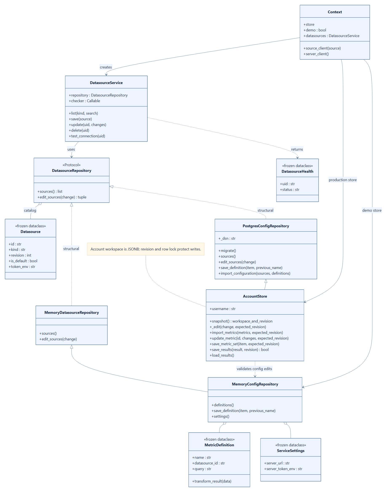

[Mermaid](diagrams/classes-service.mmd) · [SVG](images/classes-service.svg) · [PNG](images/classes-service.png)

Код: `detectors/apps/services/{datasources,configuration,postgres,accounts}.py; ui/src/atropos_ui/context.py`.

### Классы каталога метаданных

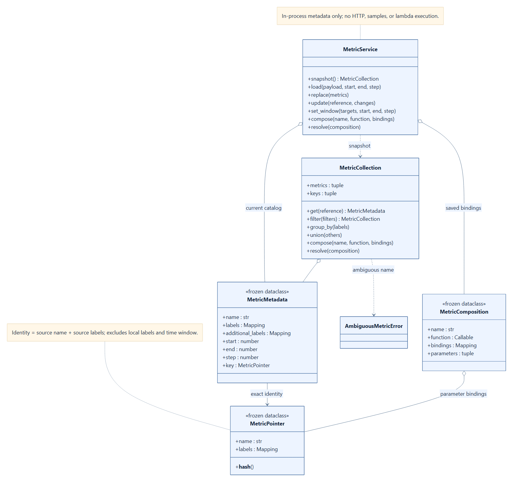

[Mermaid](diagrams/classes-metadata.mmd) · [SVG](images/classes-metadata.svg) · [PNG](images/classes-metadata.png)

Код: `detectors/apps/services/{metrics,metadata,collection,composition}.py`.

### Классы детекторов и рантаймов

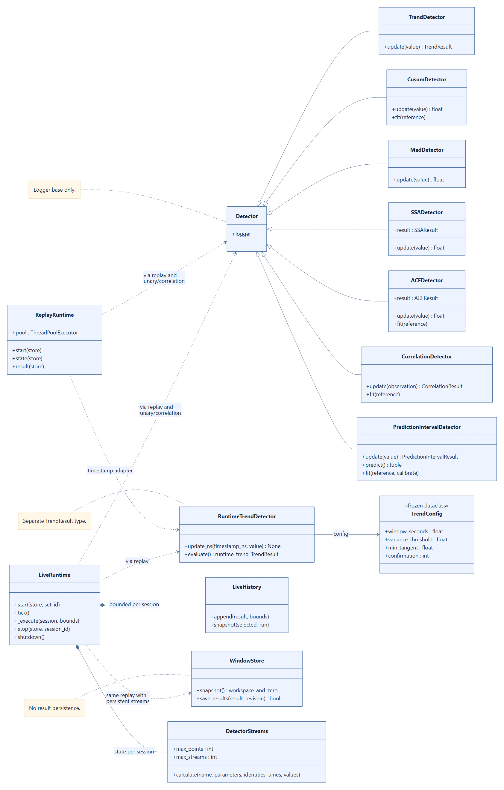

[Mermaid](diagrams/classes-detectors.mmd) · [SVG](images/classes-detectors.svg) · [PNG](images/classes-detectors.png)

Код: `detectors/apps/{detectors,runtime_trend}.py; ui/src/atropos_ui/{detector_runtime,live_runtime}.py`.

### Replay: чтение, расчёт и публикация

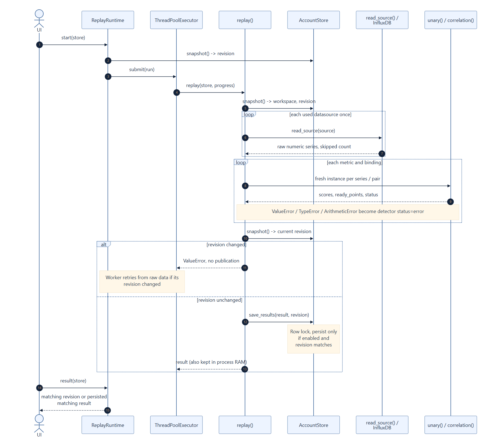

[Mermaid](diagrams/sequence-replay.mmd) · [SVG](images/sequence-replay.svg) · [PNG](images/sequence-replay.png)

Код: `ui/src/atropos_ui/detector_runtime.py; detectors/apps/services/accounts.py`.

### Live: планировщик текущих окон

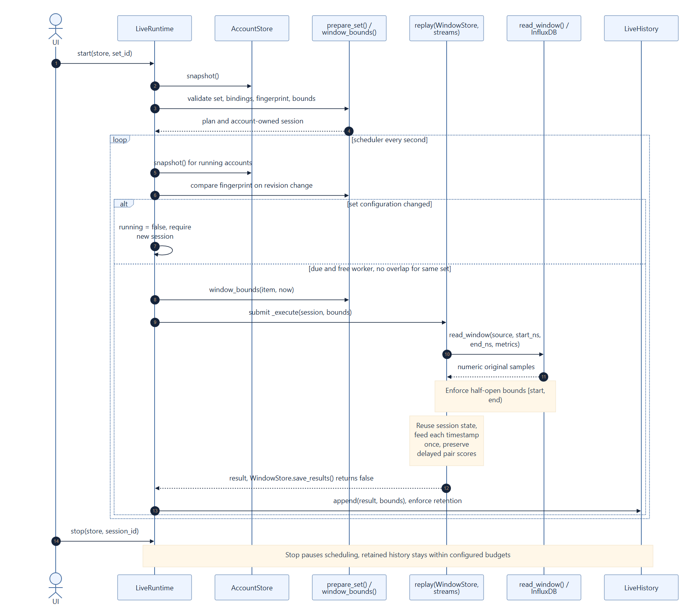

[Mermaid](diagrams/sequence-live.mmd) · [SVG](images/sequence-live.svg) · [PNG](images/sequence-live.png)

Код: `ui/src/atropos_ui/live_runtime.py; ui/src/atropos_ui/influx.py`.

### Trend: изменение наклона

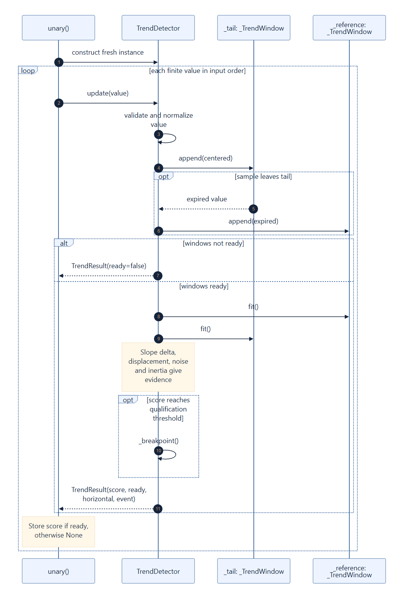

[Mermaid](diagrams/sequence-trend.mmd) · [SVG](images/sequence-trend.svg) · [PNG](images/sequence-trend.png)

Код: `ui/src/atropos_ui/detector_runtime.py; detectors/apps/detectors.py`.

### CUSUM: двунаправленное отклонение

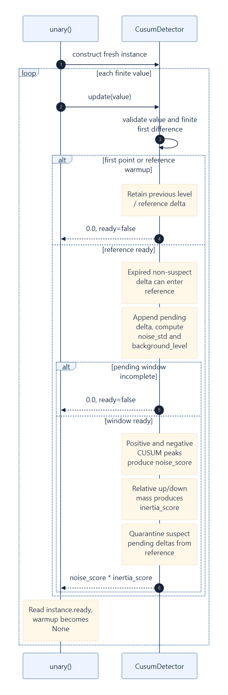

[Mermaid](diagrams/sequence-cusum.mmd) · [SVG](images/sequence-cusum.svg) · [PNG](images/sequence-cusum.png)

Код: `ui/src/atropos_ui/detector_runtime.py; detectors/apps/detectors.py`.

### MAD: изменение среднего абсолютного отклонения

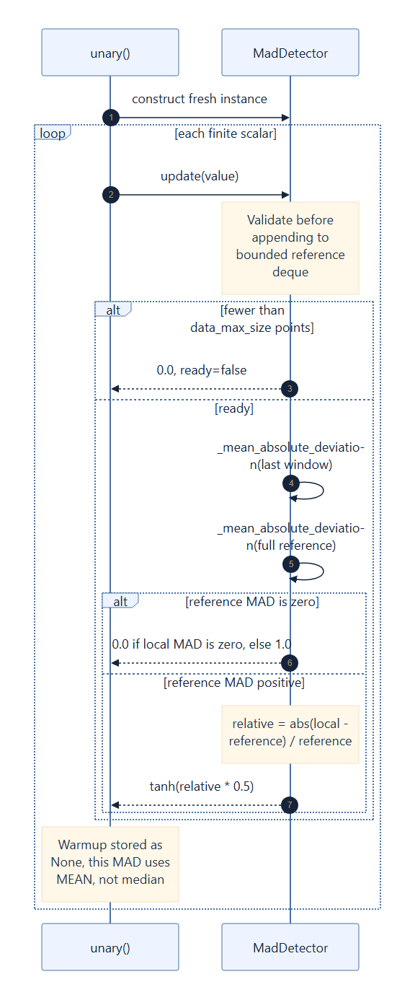

[Mermaid](diagrams/sequence-mad.mmd) · [SVG](images/sequence-mad.svg) · [PNG](images/sequence-mad.png)

Код: `ui/src/atropos_ui/detector_runtime.py; detectors/apps/detectors.py`.

### SSA: изменение структуры ряда

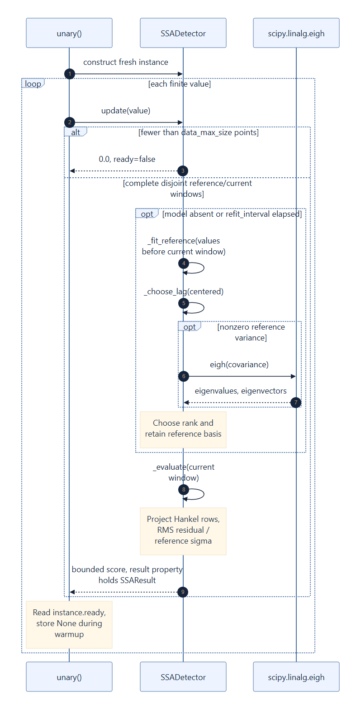

[Mermaid](diagrams/sequence-ssa.mmd) · [SVG](images/sequence-ssa.svg) · [PNG](images/sequence-ssa.png)

Код: `ui/src/atropos_ui/detector_runtime.py; detectors/apps/detectors.py`.

### ACF: изменение профиля автокорреляции

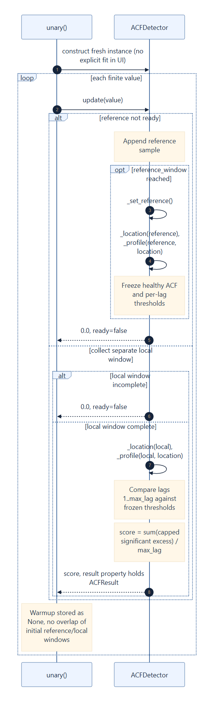

[Mermaid](diagrams/sequence-acf.mmd) · [SVG](images/sequence-acf.svg) · [PNG](images/sequence-acf.png)

Код: `ui/src/atropos_ui/detector_runtime.py; detectors/apps/detectors.py`.

### Correlation: согласование пары и задержанный score

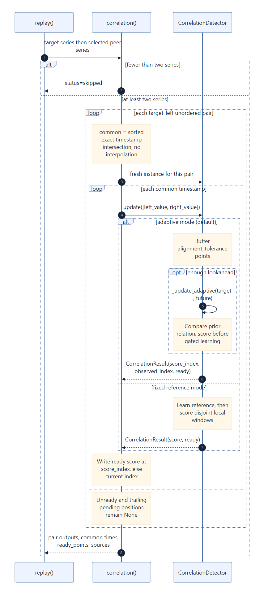

[Mermaid](diagrams/sequence-correlation.mmd) · [SVG](images/sequence-correlation.svg) · [PNG](images/sequence-correlation.png)

Код: `ui/src/atropos_ui/detector_runtime.py; detectors/apps/detectors.py`.

### PredictionInterval: оценка до обучения

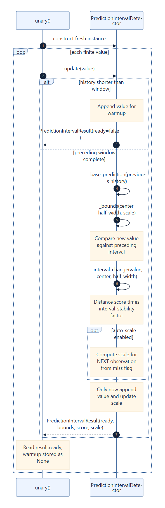

[Mermaid](diagrams/sequence-prediction-interval.mmd) · [SVG](images/sequence-prediction-interval.svg) · [PNG](images/sequence-prediction-interval.png)

Код: `ui/src/atropos_ui/detector_runtime.py; detectors/apps/detectors.py`.

### RuntimeTrend: тренд по реальному времени

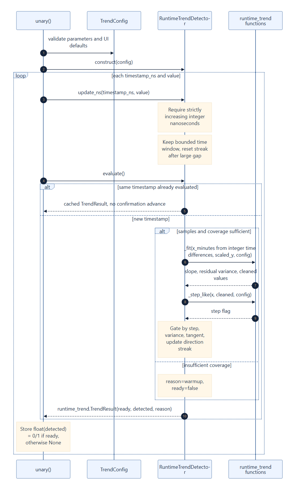

[Mermaid](diagrams/sequence-runtime-trend.mmd) · [SVG](images/sequence-runtime-trend.svg) · [PNG](images/sequence-runtime-trend.png)

Код: `ui/src/atropos_ui/detector_runtime.py; detectors/apps/runtime_trend.py`.

## Обновление схем

После изменения `.mmd` выполните из корня репозитория:

```powershell
python docs/render_diagrams.py
# Если Mermaid уже загружен:
python docs/render_diagrams.py --mermaid-js C:/path/to/mermaid.min.js
```

Рендер использует Chrome или Edge в headless-режиме и Mermaid 11.12.0 с проверкой SHA-256. При первом запуске загружается только закреплённый JS. Путь браузера можно задать через `--browser`. Python-пакеты для рендеринга не требуются. Временный профиль браузера создаётся в системной temp-папке и удаляется после завершения.

Исходный снимок: [SHA-256 файлов](validation/source-manifest.json), [классы и методы с номерами строк](validation/class-inventory.json). Проверки и команды: [отчёт](INTEGRITY_REPORT.md). Результат рендеринга и размеры изображений: [render-manifest.json](images/render-manifest.json).
